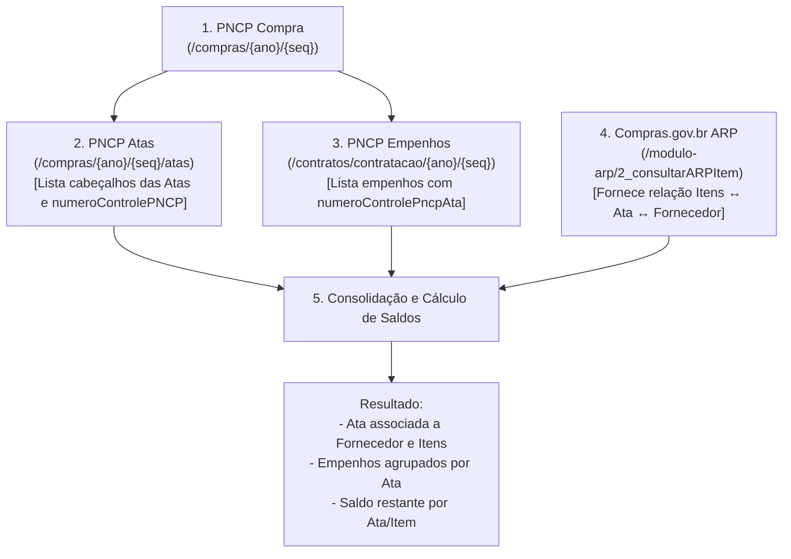

# Atas de Registro de Preços (ARP): empenhos, itens e saldos

> Documento de planejamento e referência técnica consolidada.
> Atualizado em: 20/11/2026 com os resultados das investigações empíricas em Compras.gov.br (Dados Abertos), Contratos.gov.br e PNCP.

---

## 1. Problema e Objetivo

Atualmente, o relatório apresenta por item da contratação a quantidade homologada e a quantidade empenhada total. No entanto, quando a compra é realizada sob o **Sistema de Registro de Preços (SRP)**:
- Não exibe a relação de Atas de Registro de Preços (ARPs) geradas;
- Não associa formalmente quais empenhos consumiram saldo de qual Ata;
- Não detalha os órgãos gerenciadores e participantes (UGs participantes e caronas);
- Não aponta o saldo remanescente específico de cada Ata/fornecedor.

Este plano consolida o mapeamento das APIs públicas federais, os achados técnicos (o que funciona e o que não funciona na prática) e a arquitetura recomendada para a implementação.

---

## 2. Diagnóstico das APIs e Fatos Verificados

Entre 14/11/2026 e 20/11/2026, foram realizados testes práticos e inspeções de schemas em três ecossistemas de APIs:

### 2.1. API Dados Abertos Compras.gov.br (`dadosabertos.compras.gov.br/v3`)

| Endpoint | O que faz / O que retorna | Viabilidade / Achados práticos |
|---|---|---|
| `GET /modulo-contratacoes/1.1_consultarContratacoes_PNCP_14133_Id` | Busca a compra por `numeroControlePNCPCompra` | **Funciona** (200). Retorna metadados da compra, UASG (`unidadeOrgaoCodigoUnidade`) e `numeroCompra`. |
| `GET /modulo-arp/2_consultarARPItem` | Lista itens de ARPs por UASG e `numeroCompra` | **Funciona com ressalvas**. Retorna os itens de todas as atas da compra com `numeroAtaRegistroPreco`, `numeroItem`, fornecedor (`niFornecedor`), quantidades e `numeroControlePncpAta`. **Porém**, o campo `quantidadeEmpenhada` retorna sistematicamente `0.0`. |
| `GET /modulo-arp/3_consultarUnidadesItem` | Consulta UGs participantes por Ata e Item | **Funciona**. Retorna quais UGs (gerenciadora e participantes) possuem cota registrada para aquele item, além de limites de adesão. |
| `GET /modulo-arp/4_consultarEmpenhosSaldoItem` | Deveria consultar os empenhos e saldos por item de cada Ata | **NÃO ALIMENTADO**. Responde 200 com lista vazia `{"resultado": [], "totalRegistros": 0}`, mesmo em atas de 2024, 2025 e 2026 com dezenas de empenhos ativos emitidos. A view `VwArpEmpenhosItem` não reflete as execuções da Lei 14.133/2021. |
| `GET /modulo-arp/5_consultarAdesoesItem` | Consulta autorizações de adesão (caronas) | Requer `numeroAta`, `unidadeGerenciadora` e `numeroItem`. Retorna registros quando há pedidos de adesão tramitados no Compras.gov.br. |

### 2.2. API PNCP (`pncp.gov.br`)

| Endpoint | O que faz / O que retorna | Viabilidade / Achados práticos |
|---|---|---|
| `GET /api/pncp/v1/orgaos/{cnpj}/compras/{ano}/{seq}/atas` | Lista todas as atas publicadas para a contratação | **Excelente** (200). Retorna `numeroAtaRegistroPreco`, `anoAta`, `sequencialAta`, `numeroControlePNCP` (ex: `...-000001`), vigência, cancelamento e `possibilidadeAdesao`. **Não traz itens nem fornecedor**. |
| `GET /api/pncp/v1/orgaos/{cnpj}/contratos/contratacao/{ano}/{seq}` | Lista todos os contratos e empenhos da compra | **FONTE PRIMÁRIA DOS EMPENHOS**. Retorna 200 com paginação completa. Cada empenho possui o campo chave: **`numeroControlePncpAta`** (ex: `10635424000186-1-000282/2025-000013`), além de UG emitente, valor global, fornecedor e datas. |
| `GET .../atas/{sequencial}/itens` | Tentativa de obter itens da ata no PNCP | **404** (Endpoint inexistente no PNCP). |

### 2.3. API Contratos.gov.br (`contratos.comprasnet.gov.br`)

| Endpoint | O que faz / O que retorna | Viabilidade / Achados práticos |
|---|---|---|
| `GET /api/contrato/ugorigem/{ug}/numeroano/{numero}` | Busca registro por UG e número | **Funciona** público para empenhos e contratos (ex.: para `2026NE000195` ou número de contrato sem barra). |
| `GET /api/contrato/{id}/itens` | Retorna os itens empenhados com `numero_item_compra`, quantidade e valor unitário | **Funciona**. Permite auditar exatamente quais itens da licitação constam na nota de empenho. |
| Endpoints `/api/v1/empenho/...` | Rotas de empenhos do módulo Contratos | Exigem autenticação Bearer JWT (retornam 401 para acesso anônimo). |

---

## 3. Síntese da Resolução de Vínculos

1. **Atas existentes**: Obtidas via `GET /compras/{ano}/{seq}/atas` (PNCP).
2. **Empenhos vinculados**: Obtidos via `GET /contratos/contratacao/{ano}/{seq}` (PNCP). Cada empenho que possui `numeroControlePncpAta` é atribuído diretamente à sua respectiva ata.
3. **Itens e fornecedor da Ata**:
   - *Via Compras.gov.br*: O endpoint `/modulo-arp/2_consultarARPItem` fornece quais itens pertencem a qual `numeroAtaRegistroPreco` e o `niFornecedor` vencedor.
   - *Fallback PNCP*: Caso Compras.gov.br esteja indisponível, o fornecedor da ata é determinado pelo `niFornecedor` dos empenhos vinculados e os itens homologados no PNCP para aquele fornecedor.
4. **Cálculo do Saldo**:
   - `registrado(item)` = Quantidade homologada do fornecedor para o item.
   - `empenhado(item)` = Soma das quantidades empenhadas nas notas de empenho associadas àquela ata.
   - `saldo(item)` = `registrado - empenhado`.

---

## 4. Plano de Implementação

### 4.1. Fase 1: Coleta das Atas no `pncp_tracker`

- **Novo módulo**: `src/rastreador_empenhos/pncp_tracker/atas.py`
  - `consultar_atas_pncp(cnpj: str, ano: int, seq: int) -> list[dict]`:
    - Consulta `GET /api/pncp/v1/orgaos/{cnpj}/compras/{ano}/{seq}/atas`.
    - Trata paginação e retorna cabeçalhos estruturados.
  - `consultar_itens_arp_comprasnet(codigo_unidade: str, numero_compra: str) -> list[dict]`:
    - Opcional/complementar via Dados Abertos Compras.gov.br para mapeamento direto de itens da ata.
- **Persistência**: Gravar o array `atas` em `dados_pregao.json`.

### 4.2. Fase 2: Mapeamento de Empenhos por Ata (`empenho_matcher.py` / `dados_empenhos.json`)

- No processamento de empenhos:
  - Extrair `numeroControlePncpAta` de cada empenho do PNCP.
  - Agrupar empenhos sob a chave da Ata correspondente.
  - Para cada item registrado da Ata, computar:
    - Quantidade homologada/registrada;
    - Quantidade consumida por empenhos emitidos pela UG gerenciadora;
    - Quantidade consumida por adesões/participantes (outras UGs);
    - Saldo disponível para novas emissões.

### 4.3. Fase 3: Exibição no Relatório HTML

- Nova seção expansível no relatório: **"Atas de Registro de Preços (ARP)"**:
  - Tabela com: Número da Ata, Vigência, Fornecedor Vencedor, Quantidade de Itens, Valor Total Registrado, Valor Empenhado e Saldo Restante.
  - Badge de status: `Vigente`, `Expirada`, `Cancelada`.
- No detalhamento dos itens da compra:
  - Adicionar o indicador/número da Ata vinculada junto à linha de cada empenho.

---

## 5. Cuidados e Casos de Borda

1. **Empenhos sem Ata (`numeroControlePncpAta == null`)**:
   - Em compras SRP, a grande maioria dos empenhos traz a ata (no teste prático do IFC, >70% dos empenhos continham o ID da ata). Aqueles que não trazem devem ser classificados como "Empenho direto / Ata não identificada no PNCP".
2. **Endpoint `/modulo-arp/4_consultarEmpenhosSaldoItem` de Compras.gov.br**:
   - Não deve ser utilizado como fonte primária para saldo, pois permanece vazio/desatualizado. A fonte da verdade dos empenhos é o PNCP complementado pelo Portal da Transparência.
3. **Adesões de Outros Órgãos (Caronas)**:
   - Se uma UG externa emitir empenho com adesão à ata, o empenho pode aparecer na lista de contratos do PNCP associado àquela contratação com `frutoAdesao: true` e a UG emitente distinta da UG da compra.
   - Quando a quantidade empenhada total ultrapassar a quantidade homologada original do órgão gerenciador devido a caronas autorizadas, marcar o item com badge de `Adesão / Saldo excedente autorizado`.
