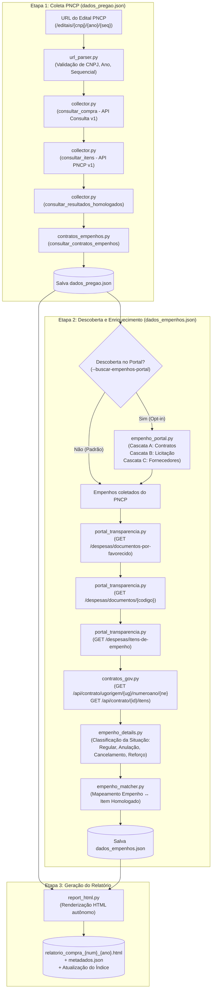

# Documentação Técnica e Arquitetura — `rastreador_empenhos`

Este documento detalha o funcionamento interno, o fluxo de execução das requisições e a organização modular do pacote `rastreador_empenhos`.

---

## 1. Fluxograma de Execução

O ciclo completo de rastreamento de um processo de contratação pública segue um pipeline em estágios desacoplados, garantindo isolamento entre a coleta no PNCP e o enriquecimento nas APIs complementares:

---

## 2. Sequência de Chamadas às APIs Externas

Todas as integrações externas operam via HTTP GET e respeitam controles de timeout e taxa de transferência:

| Etapa | Endpoint / Recurso | Serviço / Servidor | Finalidade |
|---|---|---|---|
| **1. Cabeçalho da Compra** | `/api/consulta/v1/orgaos/{cnpj}/compras/{ano}/{seq}` | PNCP Consulta | Metadados do edital, UASG, objeto, modalidade e SRP. |
| **2. Itens do Edital** | `/api/pncp/v1/orgaos/{cnpj}/compras/{ano}/{seq}/itens` | PNCP API v1 | Relação dos itens licitados (paginado, 50 por página). |
| **3. Resultados Homologados** | `/api/pncp/v1/orgaos/{cnpj}/compras/{ano}/{seq}/itens/{numItem}/resultados` | PNCP API v1 | Fornecedor vencedor, quantidade homologada e preços. |
| **4. Contratos e Empenhos** | `/api/pncp/v1/orgaos/{cnpj}/contratos/contratacao/{ano}/{seq}` | PNCP API v1 | Lista de NEs e termos vinculados pelo órgão gerenciador. |
| **5. Descoberta Opcional (A/B)**| `/api-de-dados/contratos/processo` `/api-de-dados/licitacoes/por-processo` | Portal da Transparência | Descoberta por número de processo administrativo. |
| **6. Documentos Favorecido** | `/api-de-dados/despesas/documentos-por-favorecido` | Portal da Transparência | Localiza o código completo do documento (UG + Gestão + NE). Limitado a 180 req/min. |
| **7. Detalhe e Itens da NE** | `/api-de-dados/despesas/documentos/{codigo}` `/api-de-dados/despesas/itens-de-empenho` | Portal da Transparência | Itens de despesa, descrição contábil e valores pagos/estornados. |
| **8. Quantidade Real do Item** | `/api/contrato/ugorigem/{ug}/numeroano/{ne}` `/api/contrato/{id}/itens` | Contratos.gov.br (Público) | Confirma vínculo com a compra e extrai quantidades físicas reais por item. |

---

## 3. Módulos e Responsabilidades

O pacote adota o padrão **src-layout**, isolando lógica de negócio de scripts auxiliares e arquivos de configuração:

### 3.1. Núcleo PNCP e Regras de Negócio (`pncp_tracker/`)

- **`url_parser.py`**: Validador estrito de URLs do portal PNCP (`/app/editais/{cnpj}/{ano}/{sequencial}`). Rejeita entradas malformatadas antes de iniciar o tráfego HTTP.
- **`api_client.py`**: Cliente HTTP base para comunicação com o PNCP com timeout configurado (`DEFAULT_TIMEOUT = 30s`).
- **`collector.py`**: Orquestrador da Etapa 1. Conecta-se aos endpoints do PNCP e monta o dicionário consolidado do edital, itens e resultados homologados.
- **`contratos_empenhos.py`**: Consulta contratos e empenhos publicados no PNCP para a contratação, tratando paginações e retorno 404 (ausência de contratos).
- **`portal_transparencia.py`**: Gerenciador de requisições autenticadas à API de Dados do Portal da Transparência. Implementa limitação de taxa (máximo de 180 req/min), paginação e cabeçalhos de autorização (`chave-api-dados`).
- **`contratos_gov.py`**: Cliente da API pública do Contratos.gov.br (`contratos.comprasnet.gov.br`). Obtém o identificador interno do contrato/empenho por UG e extrai os quantitativos discriminados por item.
- **`empenho_details.py`**: Motor de análise contábil. Compara valores registrados, saldos e histórico de alterações para classificar a situação do empenho:
  - `REGULAR`
  - `REFORCO`
  - `ANULACAO`
  - `CANCELAMENTO`
  - `RETIFICACAO`
- **`empenho_portal.py`**: Implementa a cascata de descoberta opcional (Estratégias A, B e C) quando o edital é processado com `--buscar-empenhos-portal`.
- **`empenho_matcher.py`**: Realiza o matching entre as linhas de notas de empenho e os itens do edital. Compara número de item, identificadores e fornecedor vencedor.
- **`empenhos.py`**: Dataclasses e estruturas canônicas que representam empenhos e suas linhas.
- **`report_service.py`**: Serviço que coordena o fluxo de ponta a ponta: aciona a coleta, persiste `dados_pregao.json`, invoca o enriquecimento, grava `dados_empenhos.json` e gera os artefatos finais.
- **`report_registry.py`**: Gerenciador do catálogo de processos (`relatorios/indice_relatorios.json`). Controla adição, remoção lógica e metadados de status.
- **`process_lock.py`**: Mecanismo de lock por arquivo interprocessos (`.private/report_update.lock`), garantindo que execuções concorrentes (CLI, cron e servidor web) não corrompam os índices ou snapshots.
- **`report_html.py`**: Gerador do arquivo HTML autônomo (standalone). Inclui inline CSS, SVG icons, scripts JavaScript de filtragem, ordenação em memória e exportação em CSV com codificação UTF-8 BOM.

### 3.2. Pontos de Entrada da CLI e Aplicação

- **`cli.py` (`rastreador-empenhos`)**: Interface interativa de terminal para processar um edital por URL.
- **`atualizar_relatorios.py` (`rastreador-empenhos-atualizar`)**: Atualizador batch em lote que itera sobre todos os processos ativos em `indice_relatorios.json`.
- **`gerar_relatorios.py` / `generate_reports_index.py` (`rastreador-empenhos-gerar-indice`)**: Re-renderizador offline. Reconstrói os HTMLs e o índice sem fazer nenhuma chamada às APIs remotas.
- **`project_root.py`**: Resolutor determinístico do diretório raiz da aplicação, permitindo que as ferramentas funcionem mesmo quando instaladas globalmente no `site-packages` via `pipx`.

### 3.3. Servidor Administrativo (`admin_web/`)

- **`app.py`**: Aplicação Flask fornecendo rotas protegidas para gerenciar processos (`/admin`), visualizar tarefas ativas e acionar re-execuções parciais.
- **`auth.py`**: Controle de autenticação e proteção contra brute force. Utiliza hashes PBKDF2 com sal e bloqueio por IP/usuário após tentativas malsucedidas.
- **`serve.py` (`rastreador-empenhos-admin`)**: Ponto de entrada que inicializa a aplicação sobre o servidor WSGI multithread **Waitress**.

---

## 4. Persistência de Dados e Estrutura dos Snapshots

Para cada processo monitorado, uma pasta é criada em `relatorios/{identificador_processo}/` contendo:

1. **`dados_pregao.json`**:
   - Snapshot puro das etapas 1 a 4.
   - Armazena cabeçalho da compra, lista de itens homologados, vencedores e contratos/empenhos brutos do PNCP.
   - Permite que reprocessamentos ocorram sem refazer consultas repetidas ao PNCP.

2. **`dados_empenhos.json`**:
   - Snapshot enriquecido das etapas 5 a 7.
   - Contém os documentos detalhados do Portal da Transparência, itens de despesa, classificação contábil e o mapa de vínculos `empenhos_por_item`.

3. **`metadados.json`**:
   - Sumário operacional: data/hora da última execução, totais homologados e empenhados, quantidade de itens pendentes e modalidade de busca no Portal.

4. **`relatorio_compra_{num}_{ano}.html`**:
   - Relatório HTML estático final, 100% autossuficiente e publicável em CDN/GitHub Pages.

---

## 5. Regras de Cálculo e Conciliação de Saldos

### Quantidade Empenhada
1. **Evidência Primária (Contratos.gov.br):** Se o empenho for auditado no Contratos.gov.br, adota-se a quantidade expressa do item (`quantidade`).
2. **Estimativa por Preço Unitário (Portal da Transparência):** Se a quantidade física não for informada diretamente, ela é estimada matematicamente:
   $$\text{Quantidade Estimada} = \frac{\text{Valor da Linha do Empenho}}{\text{Valor Unitário Homologado}}$$
   O sistema preserva até 3 casas decimais.

### Tratamento de Adesões (Caronas)
- Empenhos marcados como `frutoAdesao: true` no PNCP ou emitidos por órgãos não participantes da licitação original **não consomem o saldo homologado** do órgão gerenciador.
- Tais empenhos são exibidos em colunas e cartões específicos de *Adesões*, assegurando precisão na auditoria de saldo contratual.
